# 机场推荐2026｜机场排行榜｜稳定机场推荐｜GitHub机场推荐

> 精选 **16** 家机场，**全部完成晚高峰实测**（865 个节点）。
> 另附 **2** 家风险名单公开标注。
> 数据来源：[机场YYDS](https://www.jichangyyds.com/) · 更新于 2026-10-27

我们不做「收录一百家」的清单。市面上流传的机场清单动辄上百家，其中大量条目
连独立官网都查不到——没有可核实的信息还要写评测，那是编。

所以做了减法：只保留 **36** 家能核实到独立官网的品牌，每家都查了域名注册日期、
探测了官网可达性。其中 **16** 家已完成本站工作日晚高峰实测（下方数据表）。
**列表长度不是质量，可核实性才是。**

> 口径说明：本页引言里的「16 家」与「865 个节点」指的是
> **已完成本站晚高峰实测**的部分。清单共收录 36 家，其中跨界云、闪跃目前只有机场方提供的第三方报告、没有本站测速数据，
> 因此不在实测表内、也未计入那 865 个节点。

---

   

  <picture>
    <source media="(prefers-color-scheme: dark)" srcset="images/banner-dark.svg">
    
  </picture>

> 🏠 在网页上看更方便：**[jichangyyds.com](https://www.jichangyyds.com/)**（品牌档案、价格表、问答库都在主站）
>
> ⚠️ 订阅链接等同账号密码，不要泄露；先看[跑路 / 停止运营名单](#risk)，再下单
>
> 🧪 第一个月先**月付试水**，工作日晚高峰连测三天再考虑季付、年付

> 标签说明：`实测` 有本站晚高峰实测 · `订阅` 已确认提供订阅链接 · `新收录` 自上一次发布以来新增

## 📋 目录导航

- [📢 更新日志](#update) · [🏅 编辑推荐位](#top) · [🧭 怎么用](#howto) · [⚡ 按用途速查](#pick)
- [📊 实测数据](#tests) · [🗂️ 机场清单](#list) · [🔗 订阅链接排行榜](#sub) · [⚠️ 跑路名单](#risk)
- [📖 买前核对](#checklist) · [💻 客户端](#clients) · [🔤 线路与协议名词](#terms) · [📥 导入订阅](#import) · [🧾 订阅口径](#subcaliber)
- [📚 专题与文章](#topics) · [📰 深度文章](#deep) · [❓ 常见问题](#faq) · [📌 数据与声明](#notes)

---

## 更新日志

_这一节记录本版相对上一版的变化。_

_相关：[编辑推荐位](#top)、[机场清单](#list)_

与 2026-08-11 版相比（本版 2026-10-27）：

- **新增收录 9 家**：[大佬云](https://www.jichangyyds.com/brands/dalaoyun/)（最低月付 ¥23）、[灵猫网络](https://www.jichangyyds.com/brands/lingmao/)（最低月付 ¥25）、[榴莲云](https://www.jichangyyds.com/brands/liulianyun/)（最低月付 ¥24）、[闪电鼠](https://www.jichangyyds.com/brands/shandianshu/)（最低月付 ¥22）、[环球梯](https://www.jichangyyds.com/brands/huanqiuti/)（最低月付 ¥23）、[神行加速](https://www.jichangyyds.com/brands/shenxingjiasu/)（最低月付 ¥23）、[云界线](https://www.jichangyyds.com/brands/yunjiexian/)（最低月付 ¥25）、[拼好连](https://www.jichangyyds.com/brands/pinhaolian/)（最低月付 ¥19.9）、[极速Cloud](https://www.jichangyyds.com/brands/jisucloud/)（最低月付 ¥30）。
- 最低月付变化：无。
- **优惠码变化**：微风网络（无）。
- 「用码后」一列的口径：只在码对所有人可用、且在有效期内才显示折后价；「——」表示没有码，或码仅限新用户 / 续费用户，或已过期。本版有 15 家的码属于后两种情形，不再显示折后价。
- 风险名单：2 家；晚高峰实测：16 家、865 个节点。

**[⬆ 回到目录](#toc)**

---

## 买之前先核对这 6 件事

_下单前的六项自查，给第一次买的人看。_

_相关：[跑路名单](#risk)、[订阅口径](#subcaliber)_

1. **线路比流量更重要。** 套餐的额度没有回答线路怎样连接，也不能保证你常用时段仍有相同表现，比较时要把架构与晚高峰记录一并看。先确认你需要的使用时间和连接连续性，再读流量上限，别让一张大额度价目表替这些问题作答案。

2. **别一次买很多年。** 长期预付把更多费用留在尚未用完的周期里，服务中途停止时，折扣并不会替你补回后续服务。新服务先从月付了解起，核对公告是否持续、条款是否透明，再考虑是否续更长周期，判断方向见[付款周期与停运风险核对](https://www.jichangyyds.com/blog/ruhe-panduan-jichang-paolu/)。

3. **准备一家备用机场。** 常用服务无法继续使用时，需要转向仍能提供服务的对象，临时找替代也不能省掉身份与条款检查。提前保留公告渠道和备用入口，核实备用服务自己的使用条件，不要只收藏主页面，等地址读不到以后才发现无处查看通知。

4. **超低价要连同停运、限速和无退款风险一起看。** 标价低没有说明能够持续多久，也没有替退款规则或超额处理作承诺，这些限制应在付款前读清。留意公告维护、客服回应与异常长期促销，别仅凭优惠幅度扩大预付，也不要从低价直接给具体服务定性。

5. **先月付试一个晚高峰。** 白天能用不能代替晚间表现，观察时固定常用节点，并将晚间连接情况与白天记录对照，不用不断切换的现象代替比较。遇到卡顿还要分开查剩余额度、限速和本地网络，查阅[晚高峰记录与卡顿的区分方法](https://www.jichangyyds.com/blog/wangaofeng-ka-zenme-ban/)，再决定是否延长付款周期。

6. **看清流量倍率和设备数。** 倍率影响额度怎样扣除，上传也计入使用量，设备上限则要按对应套餐条款另读，不能只看流量总数。还应分清额度重置时间、能否结转和超额后如何处理，结合[倍率与套餐的阅读说明](https://www.jichangyyds.com/blog/liuliang-beilv-taocan/)核对，不把付款期限当作全部使用规则。

**[⬆ 回到目录](#toc)**

---

## 🏅 编辑推荐位

_编辑决定的三个推荐位，含合作关系，不是实测排名。_

_相关：[机场清单](#list)、[纯价格表](https://www.jichangyyds.com/rank/#price)_

> 以下三个位置是**编辑决定的推荐位，含合作关系**，不是按价格或实测算出来的排名；纯价格排序见[完整价格表](https://www.jichangyyds.com/rank/#price)。

| 机场品牌 | 最低月付 | 优惠码 | 用码后 | 下一步 | 标签 |
| --- | --- | --- | --- | --- | --- |
| 🥇 [跨界云](https://www.jichangyyds.com/brands/kuajieyun/) | ¥20 | `kuajie` | **¥16.00** | [查看档案](https://www.jichangyyds.com/brands/kuajieyun/) · [去购买](https://www.jichangyyds.com/go/kuajieyun/) | `订阅` |
| 🥈 [微风网络](https://www.jichangyyds.com/brands/weifengwangluo/) | ¥27 | 无 | —— | [查看档案](https://www.jichangyyds.com/brands/weifengwangluo/) · [去购买](https://www.jichangyyds.com/go/weifengwangluo/) |  |
| 🥉 [飞猫云](https://www.jichangyyds.com/brands/feimaoyun/) | ¥25 | 无 | —— | [查看档案](https://www.jichangyyds.com/brands/feimaoyun/) · [去购买](https://www.jichangyyds.com/go/feimaoyun/) | `实测` |

**[⬆ 回到目录](#toc)**

---

## 怎么用这份清单

_选机场的三步顺序。_

_相关：[按用途速查](#pick)、[机场清单](#list)_

选机场只有三步，顺序不要反：

1. **先定预算档位。** 价格分层是带宽成本决定的，不存在「又便宜又是专线」这种事。
2. **按用途挑线路。** 看 Netflix 看解锁地区，用 ChatGPT 看原生 IP，晚上刷视频看晚高峰。
3. **月付试一个晚高峰。** 工作日 21:00 连续测三天，取最低值。别一上来就买年付。

完整方法论：[2026 机场推荐排行榜](https://www.jichangyyds.com/rank/) · [档位与线路横向对比](https://www.jichangyyds.com/compare/)

**[⬆ 回到目录](#toc)**

---

## 价格档位速查

| 档位 | 价格区间 | 典型线路 | 适合谁 |
| --- | --- | --- | --- |
| 低价走量 | ¥15 – 18 | 公网直连 / 隧道中转 | 预算敏感、白天为主、先试水 |
| 主流性价比 | ¥19 – 22 | 优质 BGP 中转、部分 CN2 | 大多数人的最终落点 |
| 高价专线档 | ¥23 – 30 | IPLC / IEPL 内网专线 | 晚高峰零容忍、AI 与跨境业务 |

延伸阅读：[IPLC、IEPL、中转、直连有什么区别](https://www.jichangyyds.com/blog/iplc-iepl-zhongzhuan-zhilian/)

**[⬆ 回到目录](#toc)**

---

## 30 秒速查：按用途选

_按需求找候选；候选来自各专题页。_

_相关：[机场清单](#list)、[专题榜单](#topics)_

候选由中央库按各专题的筛选条件现算，顺序含编辑推荐位、不是实测排名；每个专题页写明了入选理由。

| 你的需求 | 先看这几家 | 为什么 / 详细专题 |
| --- | --- | --- |
| 预算有限、先试水 | [edgenova](https://www.jichangyyds.com/brands/edgenova/)、[可信云](https://www.jichangyyds.com/brands/kexinyun/)、[快狸](https://www.jichangyyds.com/brands/kuaili/) | 预算有限：先核超额后的限速规则。 [便宜机场推荐](https://www.jichangyyds.com/topics/cheap/) |
| 要稳定、晚高峰不卡 | [跨界云](https://www.jichangyyds.com/brands/kuajieyun/)、[微风网络](https://www.jichangyyds.com/brands/weifengwangluo/)、[飞猫云](https://www.jichangyyds.com/brands/feimaoyun/) | 晚间使用：对照固定节点的昼夜表现。 [晚高峰稳定机场推荐](https://www.jichangyyds.com/topics/peak-hour/) |
| 要内网专线（IPLC / IEPL） | [微风网络](https://www.jichangyyds.com/brands/weifengwangluo/)、[飞猫云](https://www.jichangyyds.com/brands/feimaoyun/)、[极速Cloud](https://www.jichangyyds.com/brands/jisucloud/) | 关注专线：先辨线路架构而非只认名称。 [专线机场推荐](https://www.jichangyyds.com/topics/dedicated-line/) |
| 用 ChatGPT / Claude 等 AI 工具 | [跨界云](https://www.jichangyyds.com/brands/kuajieyun/)、[微风网络](https://www.jichangyyds.com/brands/weifengwangluo/)、[飞猫云](https://www.jichangyyds.com/brands/feimaoyun/) | AI对话：查额度重置与剩余能否结转。 [ChatGPT 机场推荐](https://www.jichangyyds.com/topics/chatgpt/) |
| 看 Netflix / Disney+ 等流媒体 | [跨界云](https://www.jichangyyds.com/brands/kuajieyun/)、[微风网络](https://www.jichangyyds.com/brands/weifengwangluo/)、[飞猫云](https://www.jichangyyds.com/brands/feimaoyun/) | 视频观看：按画质核对可用带宽。 [流媒体解锁机场推荐](https://www.jichangyyds.com/topics/streaming/) |
| 打游戏、要低延迟 | [跨界云](https://www.jichangyyds.com/brands/kuajieyun/)、[微风网络](https://www.jichangyyds.com/brands/weifengwangluo/)、[飞猫云](https://www.jichangyyds.com/brands/feimaoyun/) | 游戏连接：把丢包情况列入检查项。 [游戏低延迟机场推荐](https://www.jichangyyds.com/topics/gaming/) |
| 苹果手机用小火箭 | [跨界云](https://www.jichangyyds.com/brands/kuajieyun/)、[微风网络](https://www.jichangyyds.com/brands/weifengwangluo/)、[飞猫云](https://www.jichangyyds.com/brands/feimaoyun/) | 小火箭：确认服务是否支持对应客户端。 [Shadowrocket 机场推荐](https://www.jichangyyds.com/topics/shadowrocket/) |
| 电脑用 Clash 系客户端 | [跨界云](https://www.jichangyyds.com/brands/kuajieyun/)、[微风网络](https://www.jichangyyds.com/brands/weifengwangluo/)、[飞猫云](https://www.jichangyyds.com/brands/feimaoyun/) | Clash导入：先问订阅链接怎样取得。 [Clash 机场推荐](https://www.jichangyyds.com/topics/clash/) |
| 想先免费试用 | [edgenova](https://www.jichangyyds.com/brands/edgenova/)、[可信云](https://www.jichangyyds.com/brands/kexinyun/)、[快狸](https://www.jichangyyds.com/brands/kuaili/) | 先试用：查是否提供试用及退款约定。 [免费试用机场推荐](https://www.jichangyyds.com/topics/trial/) |
| 想找优惠码 | [跨界云](https://www.jichangyyds.com/brands/kuajieyun/)、[一翻云](https://www.jichangyyds.com/brands/yifanyun/)、[极速Cloud](https://www.jichangyyds.com/brands/jisucloud/) | 使用优惠：连同付款周期核对套餐限制。 [机场优惠码推荐](https://www.jichangyyds.com/topics/coupon/) |

**[⬆ 回到目录](#toc)**

---

## 客户端怎么选

_按设备平台找客户端。_

_相关：[导入订阅](#import)、[线路与协议名词](#terms)_

| 平台 | 客户端 | 一句话 |
| --- | --- | --- |
| Windows | Clash Verge Rev | 基于Tauri的图形客户端，在Windows依赖WebView2且不支持Windows 7；截至2026-10-26的最新发布v2.5.8，发布日期2026-10-09。 |
| Windows | v2rayN | 覆盖Windows、Linux、macOS的图形客户端，Windows要求10及以上，发布包含部分内核；截至2026-10-26的最新发布7.25.6，发布日期2026-10-11。 |
| macOS | Clash Verge Rev | 支持macOS，项目发布记录参照上方同名客户端一行，具体平台文件以官方页面为准。 |
| iOS | Shadowrocket（付费） | iOS付费应用，自身不附带代理服务或服务器资源，连接配置需另行准备，其他信息以官方页面为准。 |
| Android | Clash Meta for Android（CMFA） | 面向Android的规则隧道客户端，使用mihomo内核；截至2026-10-26的最新发布v2.11.36，发布日期2026-10-21。 |
| Android | FlClash | 使用ClashMeta的跨平台开源客户端，许可证为GPL-3.0；截至2026-10-26的最新发布v0.9.2，发布日期2026-10-24。 |
| Android | v2rayNG | 与v2rayN同在2dust账号下的Android项目，APK按处理器架构分别提供；截至2026-10-26的最新发布2.3.11，发布日期2026-10-11。 |
| 路由器 | OpenClash | 安装使用环境为OpenWrt路由器，项目定位是其上的Clash客户端，当前发布版本以官方页面为准。 |

先按设备平台找对应项目，再检查服务给出的订阅格式与所用客户端是否匹配，不把名称相近当作兼容保证。mihomo是处理代理连接的内核，Clash Verge Rev、FlClash与CMFA是使用它的图形客户端，不能将内核版本和界面版本互换。需要继续核对Clash系项目，可查看[Clash客户端与订阅资料](https://www.jichangyyds.com/topics/clash/)，再按相应项目说明选文件。

## 线路与协议名词

_线路与协议名词，只讲定义。_

_相关：[客户端怎么选](#clients)、[实测数据](#tests)_

| 名词 | 一句话定义 |
| --- | --- |
| IPLC | 国际专线电路，用点对点物理电路描述两端之间的跨境通道，属于线路架构名称，而非客户端或传输协议名称。 |
| IEPL | 国际以太网专线，依托运营商MPLS网络构建跨境通道，经运营商内网到境外，不把它与公网国际出口混作同一段路径。 |
| 中转 | 先接入国内入口服务器，再由入口转发至境外落地服务器，跨境部分仍走公网，描述的是经过入口转发的连接架构。 |
| 直连 | 由客户端直接连接境外服务器，跨境流量经过公网国际出口，属于线路路径的描述，不是特定代理协议的名称。 |
| BGP | 在这里的线路介绍中，指入口接入多家运营商并作路径选择的安排，讨论国内入口部分，不能拿来直接当作跨境专线定义。 |
| CN2 | 电信的国际网络名称，资料区分GT和GIA两档，仍属于公网线路，与是否采用运营商内网专线不是同一项说明。 |
| Trojan | 由trojan-gfw维护规范的代理协议，客户端先进行真实TLS握手，再用密码的SHA224摘要认证，UDP数据封装在连接内。 |
| VMess | v2fly将它描述为V2Ray原创的加密通信协议，基于TCP并依赖系统时间，Xray也有对应文档。 |
| Shadowsocks | 官方将其描述为大致基于SOCKS5的分离式代理，本地组件加密后交给远端组件转发，规范分别定义TCP和UDP。 |
| AnyTLS | 试图缓解TLS嵌套握手指纹问题的TLS代理协议，以anytls-go作为参考实现，包含认证、会话复用与可更新的填充方案。 |
| Hysteria2 | 基于QUIC承载TCP和UDP代理连接的协议，规范由Hysteria项目维护，Hysteria 2与原有版本采用不同的新协议。 |
| TUIC | 为转发TCP和UDP而设计的协议规范，主要面向QUIC，规范仓库没有官方实现，实际实现由第三方提供且不同版本不保证兼容。 |

路径属于线路架构，协议是客户端与服务器约定的传输方式，两类名称应分别核对，继续阅读[专线、中转与直连的架构区别](https://www.jichangyyds.com/blog/iplc-iepl-zhongzhuan-zhilian/)。

**[⬆ 回到目录](#toc)**

---

## 订阅链接怎么导入

_三种常用客户端怎么导入订阅链接。_

_相关：[订阅口径](#subcaliber)、[订阅链接排行榜](#sub)_

订阅链接应按账号凭据保管，不向他人转发。开始前核对服务是否提供订阅、是否支持所选客户端；未提供订阅时，以下导入路径不适用。

### Clash Verge Rev

1. 从服务的用户中心取得Clash格式的“你的订阅链接”，先核对格式，不把通用订阅当作同一内容。
2. 打开“订阅（Profiles）”页面，粘贴“你的订阅链接”并导入，查看是否出现对应配置，再继续启用。
3. 启用刚导入的配置，到“代理”页面查看策略组和节点，按要用的节点选择，不把导入与启用混成一步。
4. 系统代理在“设置”中开启，日常使用“规则（Rule）”模式，避免把所有流量都当成需要代理的内容。
5. 给订阅设置自动更新，使节点与规则能够跟随提供方变化，不一直依赖早先导入的旧内容。

对应说明：[Clash格式订阅的取得、导入与启用](https://www.jichangyyds.com/blog/clash-daoru-dingyue-jiaocheng/)。

### Shadowrocket

1. 先查服务是否支持Shadowrocket及其订阅格式，不把购买客户端等同于已经获得代理服务或节点。
2. 从对应入口复制“你的订阅链接”，确认是给Shadowrocket的格式，不把Clash的YAML订阅直接当作同一链接。
3. 将“你的订阅链接”用于客户端的订阅导入，具体界面路径以官方页面为准，不从其他客户端照搬菜单位置。
4. 打开订阅自动更新，让后续新增、删除与地址变更能够更新到客户端，别只保留初次导入的信息。
5. 日常按规则模式使用，再按需要核对“按需连接（On Demand）”，不要把全局模式当成相同的流量处理方式。

继续核对：[Shadowrocket订阅格式与使用准备](https://www.jichangyyds.com/blog/shadowrocket-jichang-tuijian/)。

### v2rayN

1. 查看服务是否单列v2rayN或v2rayNG订阅入口，并核对相应协议支持，先确认客户端与服务提供的内容匹配。
2. 取得v2ray格式的“你的订阅链接”，不要拿Clash的YAML链接代替，也不要把订阅内容当作节点由客户端自行提供。
3. 按客户端说明导入“你的订阅链接”，具体点击顺序以官方页面为准，不能只用其他应用的界面名称推定。
4. 初始按系统代理方式检查使用情况，只有遵守该设置的程序才会走代理，不将它理解成覆盖所有程序。
5. 不要同时启动另一客户端争用系统代理设置，遇到问题先区分订阅格式、剩余额度与本地网络，再判断服务端情况。

相关说明：[v2rayN订阅要求与系统代理范围](https://www.jichangyyds.com/blog/v2rayn-jichang-tuijian/)。

需要先理解链接由谁提供及怎样保管，可读[订阅链接排行榜：哪些品牌提供订阅链接](https://www.jichangyyds.com/dingyue/)。

**[⬆ 回到目录](#toc)**

---

## 晚高峰实测数据（16 家）

_本站晚高峰实测数据与读法。_

_相关：[机场清单](#list)、[线路与协议名词](#terms)_

**865 个节点**，采集于 2026-07-19 至 07-21 每晚 21:00–22:00（工作日晚高峰）。

为什么只认晚高峰：白天带宽富余，任何机场都跑得好看。只有工作日 20:00–23:00
的表现才代表日常体验。

| 机场品牌 | 节点数 | 香港中位速度 | 香港中位延迟 | 测试入口 |
| --- | ---: | ---: | ---: | --- |
| [飞猫云](https://www.jichangyyds.com/brands/feimaoyun/) | 86/88 | 60.48 MB/s | 37ms | A-张家口电信@1Gbps |
| [一翻云](https://www.jichangyyds.com/brands/yifanyun/) | 84/85 | 145.64 MB/s | 41ms | A-阳江电信@2Gbps |
| [星岛梦](https://www.jichangyyds.com/brands/xingdaomeng/) | 87/88 | 54.76 MB/s | 51ms | A-上海Azure微软云@10Gbps |
| [光速云](https://www.jichangyyds.com/brands/guangsuyun/) | 48/48 | 123.1 MB/s | 36.5ms | A-上海联通@2Gbps |
| [二猫云](https://www.jichangyyds.com/brands/ermaoyun/) | 40/40 | 93.32 MB/s | 36ms | A-阳江电信@2Gbps |
| [全球云](https://www.jichangyyds.com/brands/quanqiuyun/) | 32/33 | 86.73 MB/s | 41ms | A-佛山联通@2Gbps |
| [唯兔云](https://www.jichangyyds.com/brands/weituyun/) | 29/30 | 73.25 MB/s | 50ms | A-长沙电信@2Gbps |
| [U1S1](https://www.jichangyyds.com/brands/u1s1/) | 49/49 | 78.94 MB/s | 11ms | A-乐东电信@1Gbps |
| [极连云](https://www.jichangyyds.com/brands/jilianyun/) | 55/55 | 125.35 MB/s | 40.5ms | A-广州电信@2Gbps |
| [光年梯](https://www.jichangyyds.com/brands/guangnianti/) | 62/62 | 82.06 MB/s | 41.5ms | A-深圳移动@2Gbps |
| [edgenova](https://www.jichangyyds.com/brands/edgenova/) | 42/42 | 114.16 MB/s | 39ms | A-北京电信@2Gbps |
| [可信云](https://www.jichangyyds.com/brands/kexinyun/) | 50/50 | 121.55 MB/s | 38ms | A-杭州电信@1Gbps |
| [快狸](https://www.jichangyyds.com/brands/kuaili/) | 38/38 | 91.02 MB/s | 37.5ms | A-南京联通@2Gbps |
| [sogo云](https://www.jichangyyds.com/brands/sogoyun/) | 45/45 | 102.82 MB/s | 37ms | A-成都电信@2Gbps |
| [速界](https://www.jichangyyds.com/brands/sujie/) | 52/52 | 95.6 MB/s | 37ms | A-福州电信@2Gbps |
| [宇宙云](https://www.jichangyyds.com/brands/yuzhouyun/) | 60/60 | 94.25 MB/s | 42.5ms | A-武汉移动@2Gbps |

### ⚠️ 这张表怎么读

1. **数字是地区中位数，不是最快节点。** 每家测 30–90 个节点，取该地区全部可用节点的
   中位速度。取最快等于挑好的说，中位数才代表「随手连一个大概什么水平」。
2. **不要拿这些数字横向比较不同品牌。** 16 次测试分布在 15 条入口线路上
   （多数是各地电信 / 联通 / 移动家宽，1–2Gbps；另有一条 10Gbps 的 Azure 云主机入口），
   客户端自己的带宽上限就不一样，这部分差异和机场无关。
   **有意义的是同一品牌内部的地区差异、延迟和可用节点比例。**
   唯一的例外是一翻云与二猫云——这两家用的是同一条入口（A-阳江电信@2Gbps），彼此可比。
3. **一次测试只代表那一晚。** 机场表现会随扩容、超售、线路调整变化，
   建议自己在下单后的头一周再跑一遍。

展开：16 家晚高峰实测图（只含有本站实测数据的品牌）

<table><tr><td align="center" width="50%"><a href="https://www.jichangyyds.com/brands/feimaoyun/">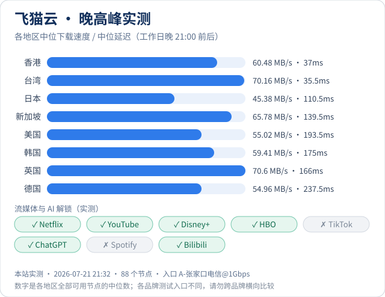</a> <a href="https://www.jichangyyds.com/brands/feimaoyun/">飞猫云</a> · 本站实测 2026-07-21 · 88 个节点</td><td align="center" width="50%"><a href="https://www.jichangyyds.com/brands/yifanyun/">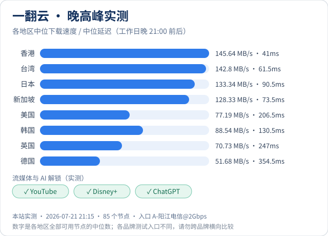</a> <a href="https://www.jichangyyds.com/brands/yifanyun/">一翻云</a> · 本站实测 2026-07-21 · 85 个节点</td></tr><tr><td align="center" width="50%"><a href="https://www.jichangyyds.com/brands/xingdaomeng/">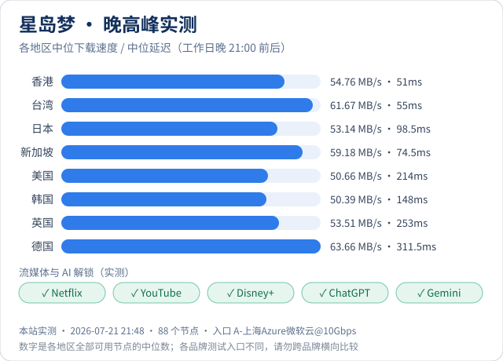</a> <a href="https://www.jichangyyds.com/brands/xingdaomeng/">星岛梦</a> · 本站实测 2026-07-21 · 88 个节点</td><td align="center" width="50%"><a href="https://www.jichangyyds.com/brands/guangsuyun/">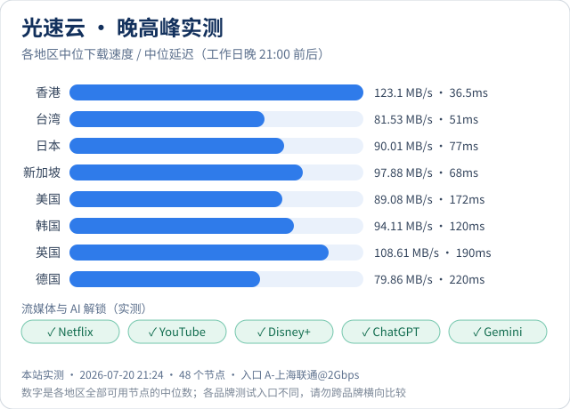</a> <a href="https://www.jichangyyds.com/brands/guangsuyun/">光速云</a> · 本站实测 2026-07-20 · 48 个节点</td></tr><tr><td align="center" width="50%"><a href="https://www.jichangyyds.com/brands/ermaoyun/">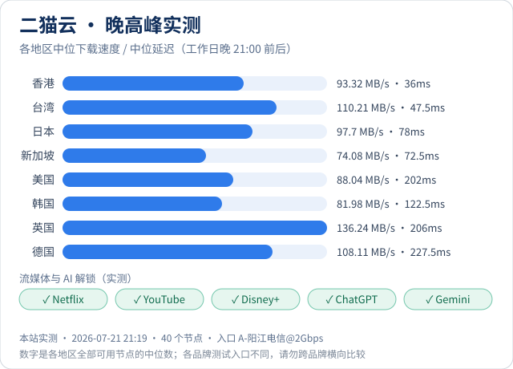</a> <a href="https://www.jichangyyds.com/brands/ermaoyun/">二猫云</a> · 本站实测 2026-07-21 · 40 个节点</td><td align="center" width="50%"><a href="https://www.jichangyyds.com/brands/quanqiuyun/">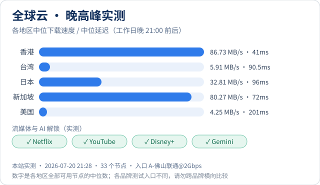</a> <a href="https://www.jichangyyds.com/brands/quanqiuyun/">全球云</a> · 本站实测 2026-07-20 · 33 个节点</td></tr><tr><td align="center" width="50%"><a href="https://www.jichangyyds.com/brands/weituyun/">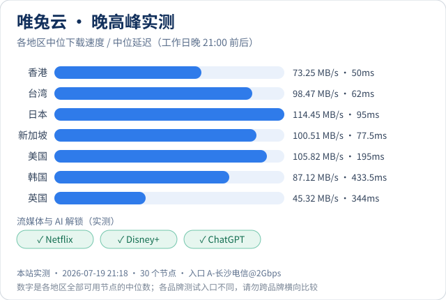</a> <a href="https://www.jichangyyds.com/brands/weituyun/">唯兔云</a> · 本站实测 2026-07-19 · 30 个节点</td><td align="center" width="50%"><a href="https://www.jichangyyds.com/brands/u1s1/">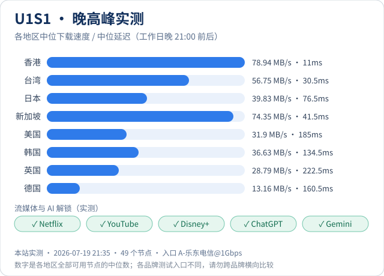</a> <a href="https://www.jichangyyds.com/brands/u1s1/">U1S1</a> · 本站实测 2026-07-19 · 49 个节点</td></tr><tr><td align="center" width="50%"><a href="https://www.jichangyyds.com/brands/jilianyun/">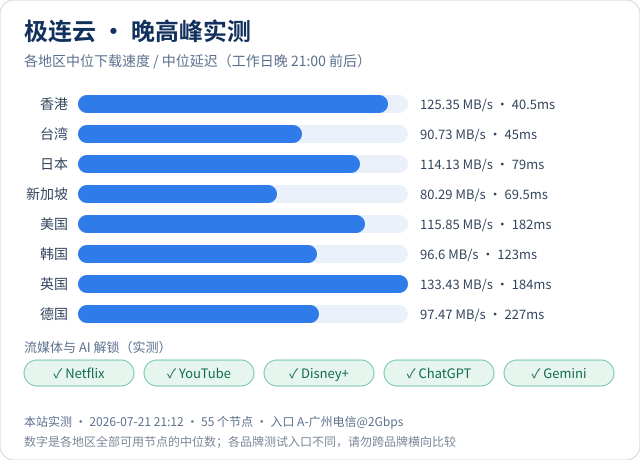</a> <a href="https://www.jichangyyds.com/brands/jilianyun/">极连云</a> · 本站实测 2026-07-21 · 55 个节点</td><td align="center" width="50%"><a href="https://www.jichangyyds.com/brands/guangnianti/">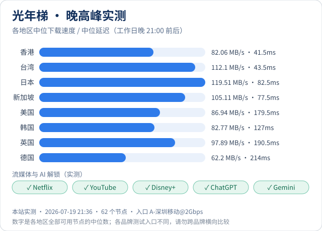</a> <a href="https://www.jichangyyds.com/brands/guangnianti/">光年梯</a> · 本站实测 2026-07-19 · 62 个节点</td></tr><tr><td align="center" width="50%"><a href="https://www.jichangyyds.com/brands/edgenova/">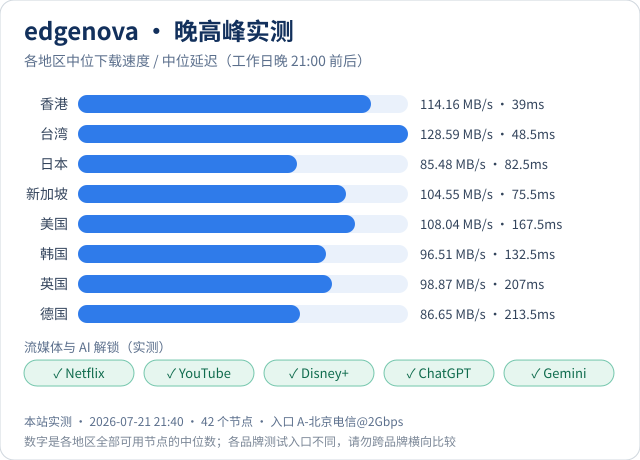</a> <a href="https://www.jichangyyds.com/brands/edgenova/">edgenova</a> · 本站实测 2026-07-21 · 42 个节点</td><td align="center" width="50%"><a href="https://www.jichangyyds.com/brands/kexinyun/">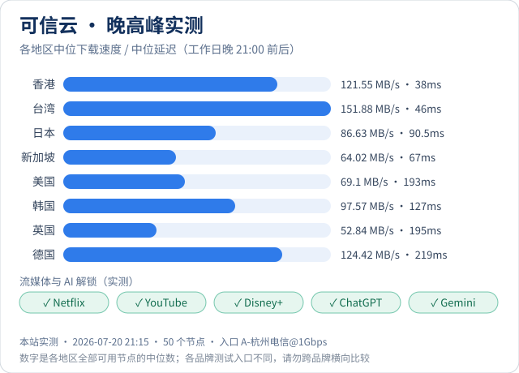</a> <a href="https://www.jichangyyds.com/brands/kexinyun/">可信云</a> · 本站实测 2026-07-20 · 50 个节点</td></tr><tr><td align="center" width="50%"><a href="https://www.jichangyyds.com/brands/kuaili/">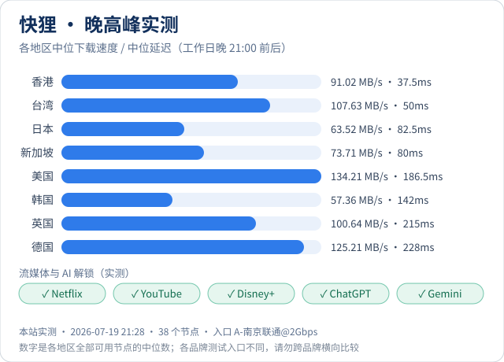</a> <a href="https://www.jichangyyds.com/brands/kuaili/">快狸</a> · 本站实测 2026-07-19 · 38 个节点</td><td align="center" width="50%"><a href="https://www.jichangyyds.com/brands/sogoyun/">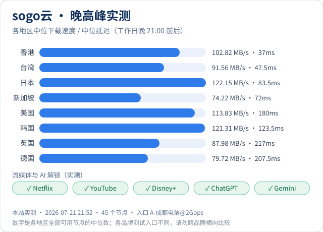</a> <a href="https://www.jichangyyds.com/brands/sogoyun/">sogo云</a> · 本站实测 2026-07-21 · 45 个节点</td></tr><tr><td align="center" width="50%"><a href="https://www.jichangyyds.com/brands/sujie/">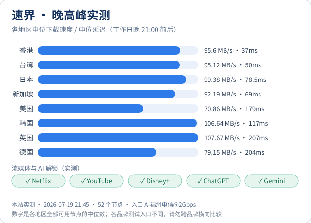</a> <a href="https://www.jichangyyds.com/brands/sujie/">速界</a> · 本站实测 2026-07-19 · 52 个节点</td><td align="center" width="50%"><a href="https://www.jichangyyds.com/brands/yuzhouyun/">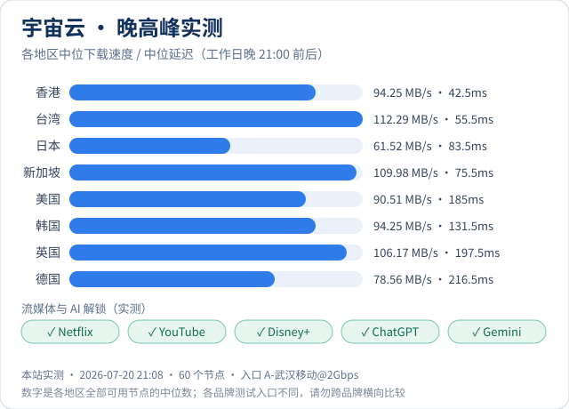</a> <a href="https://www.jichangyyds.com/brands/yuzhouyun/">宇宙云</a> · 本站实测 2026-07-20 · 60 个节点</td></tr></table>

完整数据（含日本 / 新加坡 / 美国 / 台湾 / 韩国 / 英国 / 德国各地区、以及流媒体与 AI 解锁矩阵）
见各品牌档案页。

**[⬆ 回到目录](#toc)**

---

## 在营机场清单

_按价格档位列出在营机场；标签含义见目录上方图例。_

_相关：[订阅链接排行榜](#sub)、[跑路名单](#risk)_

### 低价走量（7 家）

| 机场品牌 | 最低月付 | 优惠码 | 用码后 | 下一步 | 标签 |
| --- | --- | --- | --- | --- | --- |
| [edgenova](https://www.jichangyyds.com/brands/edgenova/) | ¥15 | `EN888` | —— | [查看档案](https://www.jichangyyds.com/brands/edgenova/) · [去购买](https://www.jichangyyds.com/go/edgenova/) | `实测` |
| [可信云](https://www.jichangyyds.com/brands/kexinyun/) | ¥15 | `KEXIN85` | **¥12.75** | [查看档案](https://www.jichangyyds.com/brands/kexinyun/) · [去购买](https://www.jichangyyds.com/go/kexinyun/) | `实测` |
| [快狸](https://www.jichangyyds.com/brands/kuaili/) | ¥15 | 无 | —— | [查看档案](https://www.jichangyyds.com/brands/kuaili/) · [去购买](https://www.jichangyyds.com/go/kuaili/) | `实测` |
| [速界](https://www.jichangyyds.com/brands/sujie/) | ¥15 | `sj888` | —— | [查看档案](https://www.jichangyyds.com/brands/sujie/) · [去购买](https://www.jichangyyds.com/go/sujie/) | `实测` |
| [光速云](https://www.jichangyyds.com/brands/guangsuyun/) | ¥17 | 无 | —— | [查看档案](https://www.jichangyyds.com/brands/guangsuyun/) · [去购买](https://www.jichangyyds.com/go/guangsuyun/) | `实测` |
| [极连云](https://www.jichangyyds.com/brands/jilianyun/) | ¥18 | 无 | —— | [查看档案](https://www.jichangyyds.com/brands/jilianyun/) · [去购买](https://www.jichangyyds.com/go/jilianyun/) | `实测` |
| [光年梯](https://www.jichangyyds.com/brands/guangnianti/) ⚠️ | ¥18 | 无 | —— | [查看档案](https://www.jichangyyds.com/brands/guangnianti/) · [去购买](https://www.jichangyyds.com/go/guangnianti/) | `实测` |

> ⚠️ **edgenova** 的折后价有适用条件：EN888 是节点故障补偿码，**仅限续费用户**，且官方标明限时 2 个月，新用户不适用
>
> ⚠️ **速界** 的折后价有适用条件：sj888 是节点故障补偿码，**仅限续费用户**，且官方标明限时 2 个月，新用户不适用
>
> ⚠️ **光年梯**：该机场 2026-04-09 公告已关闭通用订阅链接、暂不支持第三方开源客户端（Clash / v2rayN / Shadowrocket 等），需改用其自研客户端，登录识别码为 guangnianti。截至 2026-07-31 本站复核，未见解除该限制的新公告。如果你依赖第三方客户端，下单前请先向其客服确认订阅链接是否已恢复。

### 主流性价比（11 家）

| 机场品牌 | 最低月付 | 优惠码 | 用码后 | 下一步 | 标签 |
| --- | --- | --- | --- | --- | --- |
| [无忧链接](https://www.jichangyyds.com/brands/wuyoulianjie/) ⚠️ | ¥19 | `wuyou666` | —— | [查看档案](https://www.jichangyyds.com/brands/wuyoulianjie/) · [去购买](https://www.jichangyyds.com/go/wuyoulianjie/) |  |
| [唯兔云](https://www.jichangyyds.com/brands/weituyun/) | ¥19.9 | `rabbit` | **¥17.91** | [查看档案](https://www.jichangyyds.com/brands/weituyun/) · [去购买](https://www.jichangyyds.com/go/weituyun/) | `实测` |
| [拼好连](https://www.jichangyyds.com/brands/pinhaolian/) ⚠️ | ¥19.9 | 无 | —— | [查看档案](https://www.jichangyyds.com/brands/pinhaolian/) · [去购买](https://www.jichangyyds.com/go/pinhaolian/) | `订阅` `新收录` |
| [跨界云](https://www.jichangyyds.com/brands/kuajieyun/) | ¥20 | `kuajie` | **¥16.00** | [查看档案](https://www.jichangyyds.com/brands/kuajieyun/) · [去购买](https://www.jichangyyds.com/go/kuajieyun/) | `订阅` |
| [暮光加速](https://www.jichangyyds.com/brands/muguang/) | ¥20 | `mm88` | —— | [查看档案](https://www.jichangyyds.com/brands/muguang/) · [去购买](https://www.jichangyyds.com/go/muguang/) |  |
| [一翻云](https://www.jichangyyds.com/brands/yifanyun/) ⚠️ | ¥20 | `1FLYYUN` | **¥18.00** | [查看档案](https://www.jichangyyds.com/brands/yifanyun/) · [去购买](https://www.jichangyyds.com/go/yifanyun/) | `实测` |
| [二猫云](https://www.jichangyyds.com/brands/ermaoyun/) | ¥20 | `ermao888` | —— | [查看档案](https://www.jichangyyds.com/brands/ermaoyun/) · [去购买](https://www.jichangyyds.com/go/ermaoyun/) | `实测` |
| [全球云](https://www.jichangyyds.com/brands/quanqiuyun/) | ¥20 | 无 | —— | [查看档案](https://www.jichangyyds.com/brands/quanqiuyun/) · [去购买](https://www.jichangyyds.com/go/quanqiuyun/) | `实测` |
| [U1S1](https://www.jichangyyds.com/brands/u1s1/) | ¥20 | `U1S1` | —— | [查看档案](https://www.jichangyyds.com/brands/u1s1/) · [去购买](https://www.jichangyyds.com/go/u1s1/) | `实测` |
| [灵动云](https://www.jichangyyds.com/brands/lingdongyun/) | ¥20 | `ld88` | —— | [查看档案](https://www.jichangyyds.com/brands/lingdongyun/) · [去购买](https://www.jichangyyds.com/go/lingdongyun/) |  |
| [闪电鼠](https://www.jichangyyds.com/brands/shandianshu/) | ¥22 | 无 | —— | [查看档案](https://www.jichangyyds.com/brands/shandianshu/) · [去购买](https://www.jichangyyds.com/go/shandianshu/) | `新收录` |

> ⚠️ **无忧链接**：该机场已暂时关闭原订阅链接按钮，Clash / Shadowrocket 等第三方客户端需联系客服单独定制加密订阅，主推自研客户端（2026-08-03 档案记录，未见解除公告）。依赖第三方客户端的用户下单前请先向客服确认。
>
> ⚠️ **无忧链接** 的折后价有适用条件：仅限新用户首单；¥79 MINI 年付包不适用
>
> ⚠️ **拼好连**：运营方在购买流程中明确标示「无法提供相关教程和使用说明，没有退款政策」，需要自己完成客户端配置。月付 ¥19.9 / 50GB 起；限速、解锁、线路等均为运营方页面宣称，本站未做测速或实测。拼好连运营方与本站有合作关系。
>
> ⚠️ **一翻云**：该机场已全面停止发放订阅链接，改为只用官方自研客户端：用官网注册的邮箱与密码登录客户端即可，Clash / Shadowrocket 等第三方客户端用不了。（本站 2026-09-04 确认）
>
> ⚠️ **U1S1** 的折后价有适用条件：U1S1 是**新人特惠** 85 折，老用户不适用；官方注明「96 年包不适用」

### 高价专线档（18 家）

| 机场品牌 | 最低月付 | 优惠码 | 用码后 | 下一步 | 标签 |
| --- | --- | --- | --- | --- | --- |
| [大佬云](https://www.jichangyyds.com/brands/dalaoyun/) | ¥23 | 无 | —— | [查看档案](https://www.jichangyyds.com/brands/dalaoyun/) · [去购买](https://www.jichangyyds.com/go/dalaoyun/) | `新收录` |
| [环球梯](https://www.jichangyyds.com/brands/huanqiuti/) | ¥23 | 无 | —— | [查看档案](https://www.jichangyyds.com/brands/huanqiuti/) · [去购买](https://www.jichangyyds.com/go/huanqiuti/) | `新收录` |
| [神行加速](https://www.jichangyyds.com/brands/shenxingjiasu/) | ¥23 | 无 | —— | [查看档案](https://www.jichangyyds.com/brands/shenxingjiasu/) · [去购买](https://www.jichangyyds.com/go/shenxingjiasu/) | `新收录` |
| [闪跃](https://www.jichangyyds.com/brands/shanyue/) | ¥24 | `shanyue` | —— | [查看档案](https://www.jichangyyds.com/brands/shanyue/) · [去购买](https://www.jichangyyds.com/go/shanyue/) |  |
| [隐形人](https://www.jichangyyds.com/brands/yinxingren/) | ¥24 | `yxr888` | —— | [查看档案](https://www.jichangyyds.com/brands/yinxingren/) · [去购买](https://www.jichangyyds.com/go/yinxingren/) |  |
| [榴莲云](https://www.jichangyyds.com/brands/liulianyun/) | ¥24 | `ll88` | —— | [查看档案](https://www.jichangyyds.com/brands/liulianyun/) · [去购买](https://www.jichangyyds.com/go/liulianyun/) | `新收录` |
| [飞猫云](https://www.jichangyyds.com/brands/feimaoyun/) | ¥25 | 无 | —— | [查看档案](https://www.jichangyyds.com/brands/feimaoyun/) · [去购买](https://www.jichangyyds.com/go/feimaoyun/) | `实测` |
| [Firefly](https://www.jichangyyds.com/brands/firefly/) | ¥25 | `firefly` | —— | [查看档案](https://www.jichangyyds.com/brands/firefly/) · [去购买](https://www.jichangyyds.com/go/firefly/) |  |
| [灵猫网络](https://www.jichangyyds.com/brands/lingmao/) | ¥25 | 无 | —— | [查看档案](https://www.jichangyyds.com/brands/lingmao/) · [去购买](https://www.jichangyyds.com/go/lingmao/) | `新收录` |
| [星岛梦](https://www.jichangyyds.com/brands/xingdaomeng/) | ¥25 | `nmw888` | **¥22.50** | [查看档案](https://www.jichangyyds.com/brands/xingdaomeng/) · [去购买](https://www.jichangyyds.com/go/xingdaomeng/) | `实测` |
| [sogo云](https://www.jichangyyds.com/brands/sogoyun/) | ¥25 | `SOGO88` | **¥22.00** | [查看档案](https://www.jichangyyds.com/brands/sogoyun/) · [去购买](https://www.jichangyyds.com/go/sogoyun/) | `实测` |
| [宇宙云](https://www.jichangyyds.com/brands/yuzhouyun/) | ¥25 | `YUZHOU553` | **¥20.00** | [查看档案](https://www.jichangyyds.com/brands/yuzhouyun/) · [去购买](https://www.jichangyyds.com/go/yuzhouyun/) | `实测` |
| [FlyV](https://www.jichangyyds.com/brands/flyv/) | ¥25 | `fly20` | —— | [查看档案](https://www.jichangyyds.com/brands/flyv/) · [去购买](https://www.jichangyyds.com/go/flyv/) |  |
| [梯子云](https://www.jichangyyds.com/brands/tiziyun/) | ¥25 | `tiziyun` | —— | [查看档案](https://www.jichangyyds.com/brands/tiziyun/) · [去购买](https://www.jichangyyds.com/go/tiziyun/) |  |
| [云界线](https://www.jichangyyds.com/brands/yunjiexian/) | ¥25 | 无 | —— | [查看档案](https://www.jichangyyds.com/brands/yunjiexian/) · [去购买](https://www.jichangyyds.com/go/yunjiexian/) | `新收录` |
| [微风网络](https://www.jichangyyds.com/brands/weifengwangluo/) | ¥27 | 无 | —— | [查看档案](https://www.jichangyyds.com/brands/weifengwangluo/) · [去购买](https://www.jichangyyds.com/go/weifengwangluo/) |  |
| [浪网](https://www.jichangyyds.com/brands/langwang/) | ¥30 | `lw88` | —— | [查看档案](https://www.jichangyyds.com/brands/langwang/) · [去购买](https://www.jichangyyds.com/go/langwang/) |  |
| [极速Cloud](https://www.jichangyyds.com/brands/jisucloud/) ⚠️ | ¥30 | `ikds88` | —— | [查看档案](https://www.jichangyyds.com/brands/jisucloud/) · [去购买](https://www.jichangyyds.com/go/jisucloud/) | `新收录` |

> ⚠️ **Firefly** 的折后价有适用条件：仅限新用户首单；¥96 年付版不适用
>
> ⚠️ **极速Cloud**：全站套餐节点倍率 10 倍：官网标称 1000G 实际折合 100G，表中按折合值展示（折合数字为运营方标注）。运营方明示无退款、禁止 BT 下载；新人 100G 体验 ¥15 仅限新人且只支持月付。推广入口落到裸 IP，IP 变更或被封时链接会断；线路与覆盖地区均为运营方自述，本站未核实。

**[⬆ 回到目录](#toc)**

---

## 订阅链接排行榜

_已确认提供订阅链接的外部品牌。_

_相关：[订阅口径](#subcaliber)、[导入订阅](#import)_

想把节点导入 Clash、Shadowrocket 这类第三方客户端，要先确认商家给不给订阅链接。下面只列已经确认「提供订阅链接」的外部品牌：

| 名次 | 品牌 | 一句话 | 下一步 |
| --- | --- | --- | --- |
| 1 | 灯塔 CLOUD | 本站主推 · 提供订阅链接 · 季付三档，线路三线 IEPL | [去购买](https://www.jichangyyds.com/go/dengta/) |
| 2 | [拼好连](https://www.jichangyyds.com/brands/pinhaolian/) | 提供订阅链接 · 月付四档，最低 ¥19.9 起 | [去购买](https://www.jichangyyds.com/go/pinhaolian/) |
| 3 | [跨界云](https://www.jichangyyds.com/brands/kuajieyun/) | 提供订阅链接 · 支持第三方客户端 · 月付 ¥20 起 | [去购买](https://www.jichangyyds.com/go/kuajieyun/) |

排序是编辑决定的，含合作关系，不是按价格、速度或打分算出来的；本页没有测速，也没有评分。完整排行与依据：[订阅链接排行榜](https://www.jichangyyds.com/dingyue/)。

**[⬆ 回到目录](#toc)**

---

## 订阅链接口径汇总

_各品牌订阅链接口径一览。_

_相关：[订阅链接排行榜](#sub)、[客户端怎么选](#clients)_

Clash、Shadowrocket、v2rayN 这类第三方客户端要靠「订阅链接」导入节点。不是每家机场都给订阅链接，买之前先看这一张：

| 口径 | 品牌 |
| --- | --- |
| 支持第三方客户端，订阅链接向商家领取 | [跨界云](https://www.jichangyyds.com/brands/kuajieyun/) |
| 提供订阅链接 | [拼好连](https://www.jichangyyds.com/brands/pinhaolian/) |
| 只能用官方自研客户端 | 暂无 |
| 不提供订阅链接 | [微风网络](https://www.jichangyyds.com/brands/weifengwangluo/)、[飞猫云](https://www.jichangyyds.com/brands/feimaoyun/)、[暮光加速](https://www.jichangyyds.com/brands/muguang/)、[大佬云](https://www.jichangyyds.com/brands/dalaoyun/)、[闪跃](https://www.jichangyyds.com/brands/shanyue/)、[Firefly](https://www.jichangyyds.com/brands/firefly/)、[无忧链接](https://www.jichangyyds.com/brands/wuyoulianjie/)、[灵猫网络](https://www.jichangyyds.com/brands/lingmao/)、[一翻云](https://www.jichangyyds.com/brands/yifanyun/)、[星岛梦](https://www.jichangyyds.com/brands/xingdaomeng/)、[光速云](https://www.jichangyyds.com/brands/guangsuyun/)、[二猫云](https://www.jichangyyds.com/brands/ermaoyun/)、[全球云](https://www.jichangyyds.com/brands/quanqiuyun/)、[唯兔云](https://www.jichangyyds.com/brands/weituyun/)、[U1S1](https://www.jichangyyds.com/brands/u1s1/)、[极连云](https://www.jichangyyds.com/brands/jilianyun/)、[光年梯](https://www.jichangyyds.com/brands/guangnianti/)、[edgenova](https://www.jichangyyds.com/brands/edgenova/)、[可信云](https://www.jichangyyds.com/brands/kexinyun/)、[快狸](https://www.jichangyyds.com/brands/kuaili/)、[sogo云](https://www.jichangyyds.com/brands/sogoyun/)、[速界](https://www.jichangyyds.com/brands/sujie/)、[宇宙云](https://www.jichangyyds.com/brands/yuzhouyun/)、[FlyV](https://www.jichangyyds.com/brands/flyv/)、[梯子云](https://www.jichangyyds.com/brands/tiziyun/)、[浪网](https://www.jichangyyds.com/brands/langwang/)、[灵动云](https://www.jichangyyds.com/brands/lingdongyun/)、[隐形人](https://www.jichangyyds.com/brands/yinxingren/)、[榴莲云](https://www.jichangyyds.com/brands/liulianyun/)、[闪电鼠](https://www.jichangyyds.com/brands/shandianshu/)、[环球梯](https://www.jichangyyds.com/brands/huanqiuti/)、[神行加速](https://www.jichangyyds.com/brands/shenxingjiasu/)、[云界线](https://www.jichangyyds.com/brands/yunjiexian/) |
| 暂未确认 | [极速Cloud](https://www.jichangyyds.com/brands/jisucloud/) |

口径随商家调整，下单前以官网和客服答复为准；完整依据见 [订阅链接排行榜](https://www.jichangyyds.com/dingyue/)。

**[⬆ 回到目录](#toc)**

---

## ⚠️ 已跑路 / 停止运营名单（2 家）

_已停止运营或跑路的名单，附公开出处。_

_相关：[买前核对](#checklist)、[机场清单](#list)_

以下品牌**据社区反映**已停止运营或长期无法访问，本站因此不提供任何跳转入口。
如果你搜到某篇老文章还在推荐它们，**付款前请先自行核实官网是否仍可访问**。

> 口径：这 2 家均为 2026-07-31 之前录入，**当时未保留本站的独立核实记录**，
> 依据是社区反映与编辑判断。本站不宣称已逐家核实。
> 发现某家仍在正常运营？欢迎提 Issue —— 已发生过的更正见下方「更正记录」。

- ~~赔钱机场~~
- ~~泡泡狗机场~~

跑路前兆的识别方法（客服消失、异常年付促销、节点持续减少、被墙后不换域名等六条），
见 [怎么判断一家机场会不会跑路](https://www.jichangyyds.com/blog/ruhe-panduan-jichang-paolu/)
与 [已跑路机场名单与避坑指南](https://www.jichangyyds.com/scam/)。

### 更正记录（2 条）

本站曾把以下品牌列入上面的名单，后经复核确认有误，**已移出**。
不删掉这段、而是公开留着，是因为公开指控过就该公开更正——
[主站同步展示](https://www.jichangyyds.com/scam/)。

| 品牌 | 复核日期 | 为什么当初列错了 |
| --- | --- | --- |
| 库洛米 Kuromi | 2026-07-23 | 采集时官网返回 HTTP 429（请求过于频繁）。429 是服务端在正常响应、只是拒绝了高频探测，不等于站点不可达 —— 当时误读为不可达。经复核仍在运营，已移出。 |
| XFLTD 养鸡场 | 2026-07-31 | 本站实际访问其官网，确认仍在正常运营，此前列入有误，已移出。触发复核的是本站 GitHub 仓库的一条用户留言 —— 但移除依据是官网核实结果，不是那条留言本身：名单的编辑权不能交给被指控方。 |

**[⬆ 回到目录](#toc)**

---

## 按需求分类的榜单

_按用途、客户端、场景分类的专题榜单。_

_相关：[按用途速查](#pick)、[深度文章](#deep)_

展开：按用途 / 客户端 / 场景分类的专题榜单

- [便宜机场推荐](https://www.jichangyyds.com/topics/cheap/) — 2026 年便宜机场与高性价比机场推荐榜单：收录最低月付 ¥15 起、¥18 以内的…
- [稳定机场推荐](https://www.jichangyyds.com/topics/stable/) — 2026 稳定机场推荐。稳定不等于速度快——峰值再高，晚高峰掉一半也算不上稳。本页说…
- [专线机场推荐](https://www.jichangyyds.com/topics/dedicated-line/) — IPLC、IEPL、中转、直连有什么区别？专线机场为什么贵三倍？本页拆解四种线路架构…
- [机场优惠码推荐](https://www.jichangyyds.com/topics/coupon/) — 2026 年机场优惠码与折扣码汇总，点击即可复制，含自动特惠入口说明。先讲清楚一件事…
- [Clash 机场推荐](https://www.jichangyyds.com/topics/clash/) — Clash / Clash Verge / Clash Meta（Mihomo）用户…
- [Shadowrocket 机场推荐](https://www.jichangyyds.com/topics/shadowrocket/) — 小火箭（Shadowrocket）用户如何选择机场订阅？本页说明 iOS 端的订阅导…
- [v2rayN 机场推荐](https://www.jichangyyds.com/topics/v2rayn/) — Windows 端 v2rayN 与安卓端 v2rayNG 该怎么选机场：订阅链接怎…
- [sing-box 机场推荐](https://www.jichangyyds.com/topics/sing-box/) — sing-box 与 Hiddify 用户如何选择机场？本页说明 Hysteria2…
- [圈 X 机场推荐](https://www.jichangyyds.com/topics/quantumult-x/) — 圈 X（Quantumult X）用户如何选机场？本页说明为什么通用订阅链接在圈 X…
- [ChatGPT 机场推荐](https://www.jichangyyds.com/topics/chatgpt/) — 哪些机场适合访问 ChatGPT、Claude、Gemini 等 AI 工具？本页说…
- [流媒体解锁机场推荐](https://www.jichangyyds.com/topics/streaming/) — 「能打开」和「能看 4K」完全是两回事。本页讲清流媒体解锁的原理、同一家机场为什么不…
- [晚高峰稳定机场推荐](https://www.jichangyyds.com/topics/peak-hour/) — 机场晚高峰为什么卡？白天快、晚上慢是这个行业最普遍的抱怨。本页解释超售、共享带宽与公…
- [游戏低延迟机场推荐](https://www.jichangyyds.com/topics/gaming/) — 游戏加速能用机场吗？本页说明机场与专业游戏加速器的优化目标差异——一个优化的是带宽，…
- [免费试用机场推荐](https://www.jichangyyds.com/topics/trial/) — 免费试用机场安全吗？一元试用值不值得买？本页说明完全免费节点的真实风险——流量被转卖…
- [梯子推荐](https://www.jichangyyds.com/topics/tizi/) — 梯子推荐 2026。「梯子」是民间叫法，它可能指客户端软件、节点订阅（机场）或传统 …
- [机场梯子](https://www.jichangyyds.com/topics/jichang-tizi/) — 搜「机场梯子」的人多半刚入门。我用一页讲清：机场就是卖梯子的商家，梯子是你拿到的那条…
- [机场VPN](https://www.jichangyyds.com/topics/jichang-vpn/) — 机场和 VPN 不是一回事：VPN 给你一个软件，机场给你一条订阅。我做过 YouT…
- [飞机场推荐](https://www.jichangyyds.com/topics/feijichang/) — 「飞机场」就是机场，叫法不同。这页按每 GB 单价排，我把各家套餐算好了；节点看地区…
- [机场测评](https://www.jichangyyds.com/topics/ceping/) — 这页只有测过的品牌。每家写测试时间、节点数、存活数和解锁项；运营方测的我标运营方。没…
- [大机场推荐](https://www.jichangyyds.com/topics/da-jichang/) — 大机场的好处是不容易跑，坏处是晚高峰人多。我不按知名度排——按实测节点数、晚高峰存活…

**[⬆ 回到目录](#toc)**

---

## 深度文章

_入门、客户端、用途、避坑文章。_

_相关：[客户端怎么选](#clients)、[买前核对](#checklist)_

展开：文章封面（11 篇）

<table><tr><td align="center" width="33%"> <a href="https://www.jichangyyds.com/blog/jichang-shi-shenme/">机场是什么？和 VPN、梯子到底有什么区别</a></td><td align="center" width="33%"> <a href="https://www.jichangyyds.com/blog/iplc-iepl-zhongzhuan-zhilian/">IPLC、IEPL、中转、直连有什么区别，为什么专线贵三倍</a></td><td align="center" width="33%"> <a href="https://www.jichangyyds.com/blog/jiedian-diqu-zenme-xuan/">机场节点地区怎么选：港台日新美各适合什么场景</a></td></tr><tr><td align="center" width="33%"> <a href="https://www.jichangyyds.com/blog/liuliang-beilv-taocan/">流量倍率、套餐额度与按量计费到底怎么算</a></td><td align="center" width="33%"> <a href="https://www.jichangyyds.com/blog/clash-daoru-dingyue-jiaocheng/">Clash 订阅导入完整教程（Verge / Meta）</a></td><td align="center" width="33%"> <a href="https://www.jichangyyds.com/blog/shadowrocket-jichang-tuijian/">Shadowrocket 小火箭用户怎么选机场</a></td></tr><tr><td align="center" width="33%"> <a href="https://www.jichangyyds.com/blog/v2rayn-jichang-tuijian/">v2rayN / v2rayNG 怎么用、怎么选机场</a></td><td align="center" width="33%"> <a href="https://www.jichangyyds.com/blog/chatgpt-jichang-tuijian/">ChatGPT / Claude 等 AI 工具该选什么机场</a></td><td align="center" width="33%"> <a href="https://www.jichangyyds.com/blog/liumeiti-jiesuo-jichang/">Netflix / Disney+ / HBO 解锁机场怎么选</a></td></tr><tr><td align="center" width="33%"> <a href="https://www.jichangyyds.com/blog/wangaofeng-ka-zenme-ban/">机场晚高峰卡怎么办</a></td><td align="center" width="33%"> <a href="https://www.jichangyyds.com/blog/ruhe-panduan-jichang-paolu/">怎么判断一家机场会不会跑路</a></td></tr></table>

**入门与概念**

- [机场是什么？和 VPN、梯子到底有什么区别](https://www.jichangyyds.com/blog/jichang-shi-shenme/)
- [IPLC、IEPL、中转、直连有什么区别，为什么专线贵三倍](https://www.jichangyyds.com/blog/iplc-iepl-zhongzhuan-zhilian/)
- [机场节点地区怎么选：港台日新美各适合什么场景](https://www.jichangyyds.com/blog/jiedian-diqu-zenme-xuan/)
- [流量倍率、套餐额度与按量计费到底怎么算](https://www.jichangyyds.com/blog/liuliang-beilv-taocan/)

**按客户端**

- [Clash 订阅导入完整教程（Verge / Meta）](https://www.jichangyyds.com/blog/clash-daoru-dingyue-jiaocheng/)
- [Shadowrocket 小火箭用户怎么选机场](https://www.jichangyyds.com/blog/shadowrocket-jichang-tuijian/)
- [v2rayN / v2rayNG 怎么用、怎么选机场](https://www.jichangyyds.com/blog/v2rayn-jichang-tuijian/)

**按用途**

- [ChatGPT / Claude 等 AI 工具该选什么机场](https://www.jichangyyds.com/blog/chatgpt-jichang-tuijian/)
- [Netflix / Disney+ / HBO 解锁机场怎么选](https://www.jichangyyds.com/blog/liumeiti-jiesuo-jichang/)
- [机场晚高峰卡怎么办](https://www.jichangyyds.com/blog/wangaofeng-ka-zenme-ban/)

**避坑**

- [怎么判断一家机场会不会跑路](https://www.jichangyyds.com/blog/ruhe-panduan-jichang-paolu/)
- [机场报错排查：连不上 / 节点全红 / 订阅失效](https://www.jichangyyds.com/troubleshoot/)
- [189 条机场长尾问答库](https://www.jichangyyds.com/faq/)

**[⬆ 回到目录](#toc)**

---

## 关于数据

_数据口径、收入来源与更新说明。_

_相关：[更新日志](#update)_

- **价格**：来自各服务商公开的套餐页，取最低月付档位，以官网结算页为准。
- **排序**：上面「在营机场清单」的三张档位表按公开价格升序。
  但**晚高峰实测表用的是主站推荐顺序**，而主站推荐榜前几位为编辑推荐位、含合作关系
  （已在站内标明）。不受推荐影响的纯价格排序见 [完整价格表](https://www.jichangyyds.com/rank/#price)。
- **测速数据**：全部为本站运营方晚高峰实测，标注了采集时间与测试入口，聚合口径公开（见上）。
  行业里大量所谓「实测报告」是批量生成的、数字随机得毫无规律——所以我们把
  「什么时候测的、用什么线路测的、怎么聚合的」全部写出来，供你判断可信度。
  自测方法见[三天测试法](https://www.jichangyyds.com/blog/wangaofeng-ka-zenme-ban/)。
- **收入来源**：主站部分外链为合作推广链接，通过其下单不增加你的费用。
  这不影响我们标注风险与跑路名单——详见[收入来源公开说明](https://www.jichangyyds.com/about/)。

## 常见问题

_站内问答库的置顶问题。_

_相关：[导入订阅](#import)、[跑路名单](#risk)_

**机场是什么？**

机场是提供代理节点订阅服务的商家的俗称。你付费后拿到一条订阅链接，把它导入 Clash、Shadowrocket 这类客户端，客户端就会自动拉取商家维护的一批节点，用来访问境外网络。它卖的是节点资源和带宽，不是某一款软件。

**机场和 VPN 有什么区别？**

主要区别在协议和使用方式。传统 VPN 多用 IPSec、WireGuard 等协议接管整台设备的流量，客户端和服务端通常来自同一家；机场提供的是节点订阅，配合第三方客户端使用，可以按域名或地区做分流规则，灵活度更高，但需要自己配置客户端。

**机场推荐应该看哪些因素？**

优先看四项：线路类型与晚高峰稳定性、节点地区覆盖是否匹配你的用途、套餐流量与倍率是否够用、商家运营时长与售后响应。价格只是最后的排序条件，一个便宜但晚上不能用的机场，实际成本反而更高。

**新手怎么选择机场？**

先明确用途和预算，再从月付小套餐开始试。用途决定地区和线路：只看网页和视频选常规中转即可，需要低延迟或办公才考虑专线。首次不要直接年付，用一个月观察晚高峰表现和客服响应，合适再续长期。

**机场订阅链接怎么导入 Clash？**

打开 Clash 客户端的配置或订阅页面，选择新建配置文件并粘贴订阅链接，点击下载或更新即可生成节点列表。之后在代理页面选择节点组和具体节点，把系统代理开关打开。建议同时开启自动更新，避免节点变动后失效。

**机场晚高峰卡怎么办？**

先换节点和地区，把香港换成日本或新加坡等分流地区试试。其次改用专线或标注为高级线路的节点组。若整个机场在高峰期都不可用，说明超售严重，长期方案是更换到晚高峰表现更好的服务，而不是反复重连。

**专线机场是什么意思？**

专线机场指主力节点走运营商专用线路而非公共互联网出口，常见形式是 IPLC 或 IEPL。这类线路带宽有保障、跨境路径固定，晚高峰波动明显更小。代价是成本高，套餐价格和流量倍率通常都高于普通机场。

**怎么判断机场会不会跑路？**

没有办法完全预判，只能看概率信号：运营年限、公告与故障沟通是否透明、是否长期大幅低于成本价促销、是否频繁更换域名却不通知。风险控制比预测更有效，即控制付费周期并保留备用订阅。

完整问答库：[189 条机场长尾问答](https://www.jichangyyds.com/faq/)

**[⬆ 回到目录](#toc)**

---

## 免责声明

本仓库为第三方信息整理，不提供任何代理或网络服务，也不销售任何订阅。
信息可能存在滞后，请自行核实。请遵守你所在地区的法律法规。

## 更正与反馈

发现价格有误、某家已恢复运营、或有新的跑路案例？欢迎提 Issue。
**我们宁可错删也不漏标**——少推荐一家的损失，远小于让读者踩一次坑。
